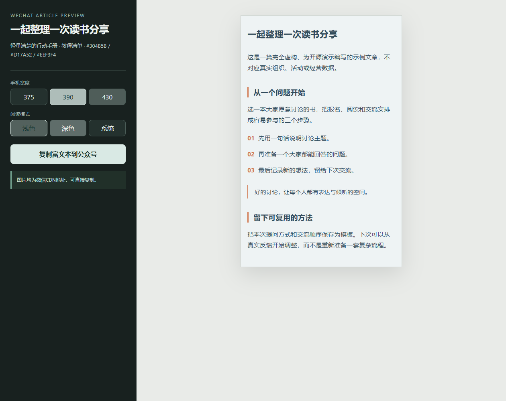

# 微信公众号文章设计 Skill

从原文、Markdown、HTML或文档内容，形成可审阅的结构化文章、微信兼容HTML、设计任务包和来源/许可报告。当前公开版本保留完整本机新版工具，并把已安装的旧版独立放在`variants/installed-v1/`。



[打开基线排版演示](https://yangwei251003.github.io/wechat-official-article-designer/)（配置Pages后可用）。示例为本仓库新写的虚构文字，展示真实脚本输出，未发送到微信，也不是正式高视觉设计的验收样稿。

## 已有能力

- 解析多种文本/办公文档，结构化Article Schema、内容锁定与修订。
- 基线HTML构建、组件/视觉方向、可选图表和静态降级接口。
- HTML/SVG清理，微信兼容、内容顺序、图片与许可登记校验。
- 素材连接器默认离线；微信草稿提供干跑、pending保护和本地Mock接口。

## 快速开始

准备Python3.12+，先创建自己的虚拟环境并安装依赖：

```powershell
python -m venv .venv
./.venv/Scripts/python -m pip install -r requirements.txt
./.venv/Scripts/python scripts/build_package.py --input examples/public-demo/source.md --output-dir output/my-demo
./.venv/Scripts/python scripts/validate_package.py output/my-demo
./.venv/Scripts/python scripts/serve_preview.py output/my-demo
```

打开预览命令返回的本机地址即可查看与复制。核心排版不需要公众号账号；SVG转换使用CairoSVG及其平台运行库，复杂动效/图表的可选外部渲染器另行准备。不要执行旧文档中仅针对原电脑的检测或安装结果。

作为Skill使用时，将本目录放入宿主的`wechat-official-article-designer/`技能目录，保留`SKILL.md`、`agents/`、`assets/`、`references/`和`scripts/`的相对位置；先备份已有版本，再按宿主方式刷新。明确调用`$wechat-official-article-designer`并提供获授权的文章。

## 外部发布与隐私

真实外部素材检索必须显式允许联网，缺凭据时用Mock或跳过。`.env.example`只有空配置名，个人`.env`、公众号正文、发布结果、token和素材私库均不能提交。微信上传/草稿是独立外部操作；只有当前用户明确要求本次写入，才使用文档中的提交模式。此次迁移没有创建微信草稿或发送消息。

## 技术、结构与验证

```text
SKILL.md / agents/      新版指令与宿主元数据
scripts/               Python确定性处理、校验、预览与发布工具
assets/ references/    自有规则/模板/示意与来源策略
tests/ evals/          原测试和确定性守卫场景
examples/public-demo/  本次新建的虚构文章和真实输出
variants/installed-v1/ 原已安装版本完整保全
docs/historical/       原开发审计，不等同当前机器事实
```

执行既有检查：

```powershell
python scripts/self_test.py
python -m unittest discover -s tests -v
python scripts/run_evals.py evals/scenarios.json
```

本次实际执行以上检查、构建及校验虚构文章、格式和敏感扫描；结果与范围见[VALIDATION.md](VALIDATION.md)。微信客户端最终浅/深色展示、真实账号接口、外部图像生成和人工设计质量仍需各自验证，不能由Mock通过证明。

## 许可与后续

本机定制项目采用AI辅助开发，自有指令/实现/程序装饰按[MIT](LICENSE)公开。外部库不随包分发，依赖遵守各自许可；上游只作机制研究，原登记保留在[研究来源](references/GITHUB_RESEARCH_REGISTRY.md)。不把软件许可扩张为第三方图片、字体或公众号内容的许可。更多边界见[PROVENANCE.md](PROVENANCE.md)。

后续优先验证新环境安装、真实客户端兼容和授权后的设计前向案例；原更新记录保留于[CHANGELOG.md](CHANGELOG.md)。

## 当前版与历史归档的安装范围

作为宿主Skill安装时，复制当前根目录及运行资源，排除variants/历史目录；历史版本保存在宿主技能扫描目录之外。直接运行仓库内Python命令不受此区分影响。

## 同项目的早期图片与片段助手

[四份完整历史程序与合成运行方法](legacy-sample-tools/README.md) · [真实合成输出预览](https://yangwei251003.github.io/wechat-official-article-designer/legacy-sample-tools/)

保全27个函数及原控制结构；真实几何图像验证接触表、指纹、模糊度、裁切、片段与交付索引。不带私人照片、文章、课程表，也没有提交或发布公众号内容。宿主表格SDK示例单独默认阻断，没有将它误称为独立通用工具。
