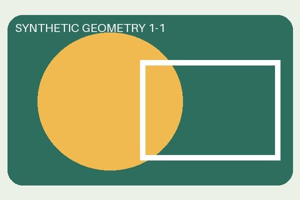
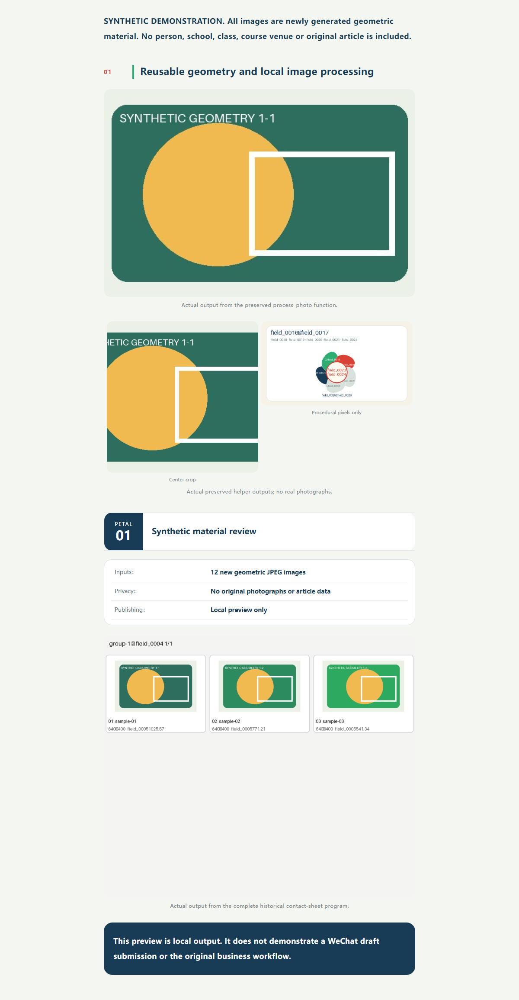

# 本地示例辅助程序归档

这里补充同一微信公众号设计项目的四个本地辅助程序，保留 **27 个原有函数及主要控制结构**：

|程序|用途|本次验证|
|---|---|---|
|`build_photo_contact_sheets.py`|图片指纹、模糊度、EXIF 时间、接触表与近邻候选|完整程序用 12 张新造几何图运行；4 张接触表、12 条图片记录、15 条近邻记录|
|`build_wechat_assets.py`|比例裁切、图片处理、封面和程序绘制花瓣素材|实际调用裁切、处理与花瓣图相关函数；原封面及全部业务素材流程未运行|
|`build_wechat_fragment.py`|微信兼容图文片段、标题、图片对话、事实卡片|7 个片段助手实际调用并在浏览器预览；原文章主流程未运行|
|`finalize_wechat_package.py`|本地 JSON 与交付包汇总|两个 JSON 助手读写合成记录；原业务交付汇总未运行|

这四份源码原本在用户创建的同一设计项目工作区中，含项目私有输入与路径。公开副本将它们改成显式合成工作区，移除原照片清单、业务文字和本机路径，字体使用 Pillow 自带默认字体。原照片、儿童资料、文章、课表、地点姓名以及私人配置没有读取或复制到公开包中。与原核心 Skill 同名的 `common` 仍是完整旧片段主流程的依赖，未把其他 Skill 或宿主 SDK 整包复制进来。

## 最简运行

Python 3.12 为实测环境。在仓库根目录运行：

```powershell
python -m venv .venv-legacy
.venv-legacy\Scripts\python -m pip install -r legacy-sample-tools/requirements.txt
.venv-legacy\Scripts\python legacy-sample-tools/demo.py --workspace .runtime/legacy-geometry-demo
```

macOS/Linux 可用 `.venv-legacy/bin/python`，跨平台未实测。工作区必须为空，程序会创建 `synthetic=true` 标记。此次实际运行使用已有 Pillow 11.0.0、NumPy 2.4.4、OpenCV 4.13.0.92；没有在本轮重新安装全新环境。

示例会创建 12 张几何 JPEG，其中 3 张是精确复制，用原指纹算法检查近邻；核验模糊评分方向、空 EXIF、400×400 裁切、600×400 处理输出和 JSON 读写。图片和正文是**新造合成数据**。默认直接执行四份历史脚本会在原导入与顶层读写之前停止，避免误对原业务目录运行。

`demo.py` 对接触表运行完整历史入口；其余部分只加载已公开源码中的函数定义与简单颜色常量，跳过业务顶层数据与原文章主流程。它没有通过重新实现原算法来制造测试结果。





[静态合成示例](../examples/legacy-sample-tools-demo/index.html)中的图片来自本机真实程序输出；它们不是原活动、原儿童照片或实物效果图。页面可以直接本地打开。GitHub Pages 子路径需主仓库发布流程复制这一示例目录后生效。

## 可选宿主检查脚本

`host-examples/inspect_course_schedule.mjs` 是同工作区的一次性表格检查适配器，归档为宿主示例，**不计作独立 Skill 或普通 Node 产品**。它依赖宿主提供的 `@oai/artifact-tool`；本仓库不分发该 SDK，也不承诺它可从公开 npm 安装。私人表格路径改成显式工作区参数，SDK 导入放在合成标记检查之后。

本次只验证其语法与默认执行阻断，未导入 SDK、未打开原课表、未测试表格检查 API。拥有兼容宿主依赖并自备合成表格时，入口形如：

```powershell
node legacy-sample-tools/host-examples/inspect_course_schedule.mjs --synthetic-demo --workspace .runtime/marked-synthetic-workspace --input inputs/example.xlsx
```

## 许可、状态与后续

自有辅助程序与本次整理部分按用户授权沿用根 MIT。第三方库及宿主 SDK 保留自身许可，见[依赖边界](THIRD_PARTY.md)；原文章、照片和业务输入没有因代码许可获得再发布授权。

本次没有连接公众号、创建或发送草稿、启动发布服务，也没有宣称完整原业务流程通过。接触表仅提供候选相似度，不是图片身份判断或人脸识别。原业务目录仍需保存，公开合成包不能替代它；当前不能列为可本地删除。

后续可根据实际复用需求，把完整旧文章/汇总流程整理为公开输入规范；当前保留原函数与控制代码，并准确注明未测试部分。
